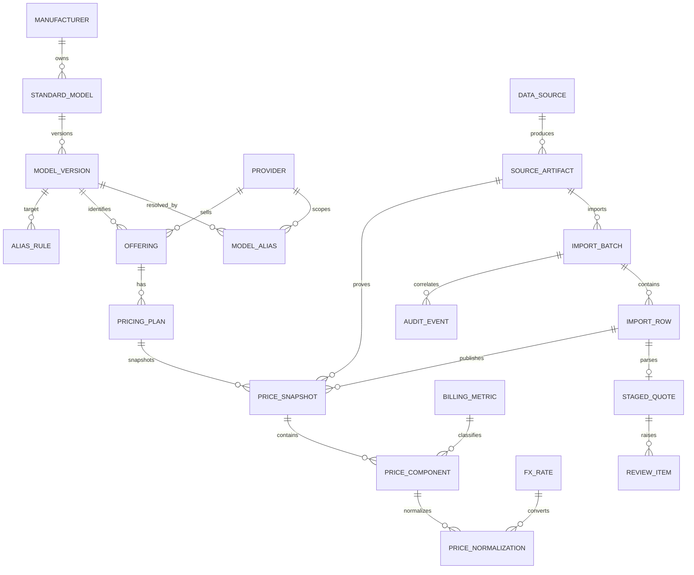

# TokenSQL 数据库与数据流设计

> 2026-10-07 需求修订：本文是旧设计基线。新计划允许 Qwen 整表/逐行语义抽取、目录创建建议与校验后的服务层自动发布；人工 review 仅用于异常。本文旧“全量 pending/人工批准”状态要求须随新版状态机调整，不能继续作为正常行自动入库的障碍。新增 Prompt/Context、整表解释、字段依据、模型/提示版本、自动/人工 validation_method 和新版幂等语义需落实迁移；不要将设计建议当已存在的列。以 [plan.md](../plan.md)、[agent_handoff.md](agent_handoff.md) 为准。

> 验收状态（2026-09-24）：本文含设计目标，验收清单不是已执行结果。当前真实数据库测试使用 SQLite；PostgreSQL 仅做离线 DDL/配置检查，尚未在实际 PostgreSQL 实例验收。有效期排斥约束等设计项应以迁移实际实现为准。最终执行记录见 progress.md。
> Excel 原件现保存在 source_artifact.raw_content（LargeBinary），附 SHA-256、原始文件名和稳定的内容定位符；上传临时文件删除不影响原件恢复。


> 状态：数据库设计基线。本文以 PostgreSQL + SQLAlchemy 2.x + Alembic 为正式实现目标，并规定 SQLite 单机原型的兼容边界。
>
> 核心原则：原始数据不可丢、历史价格只追加、歧义先审核、Qwen 不决定主键且不执行 SQL、只有同一计费语义的价格才允许比较。

## 1. 设计目标与边界

系统需要同时表示模型厂商、标准模型、实际版本、API/供应商别名、Token 供应商、供应商模型、多个报价方案和每个方案下的多个计费维度。官方价格和第三方报价共用可追溯的价格事实结构，但通过来源、报价性质与验证状态明确区分。

第一版应做到：

- 一个标准模型可有多个实际版本；一个实际版本可被多个供应商销售。
- 同一供应商对同一模型可提供多个报价方案。
- 每个报价快照可含输入、输出、缓存、秒、张、次、字符等多个计费组件。
- 原始值、原始币种、原始单位、Excel 单元格/公式和标准化结果并存。
- 报价更新生成新快照，不覆盖旧快照。
- 不确定的模型、版本、币种、单位、折扣基价和条件进入待审核区。
- 人工确认可沉淀为带版本、作用域与审计信息的别名或解析规则。

## 2. ER 关系



所有主键建议使用应用生成的 UUID。SQLAlchemy 使用可移植的 `Uuid(as_uuid=True)`；若实际版本不支持该类型，可用 PostgreSQL `UUID` 与 SQLite `CHAR(36)` 的 dialect variant。外键默认 `RESTRICT`，仅批次内部的临时记录可谨慎使用 `CASCADE`。正式价格、来源和审计数据禁止级联删除。

## 3. 表与关键字段

下列 `*_norm` 字段由应用以 Unicode NFKC、trim、连续空白折叠和 casefold 生成。必须同时保存未经修改的原始文本。

### 3.1 模型目录

#### manufacturer

- `id` UUID PK
- `code` String(64)，稳定机器标识
- `name` String(255)，展示名
- `name_norm` String(255)
- `created_at`、`updated_at` UTC 时间

约束：`UNIQUE(code)`，`UNIQUE(name_norm)`。

#### standard_model

表示产品族/标准模型，不把日期版本或供应商别名混入其中。

- `id` UUID PK
- `manufacturer_id` FK
- `canonical_name`、`canonical_name_norm`
- `modality`：text/image/audio/video/multimodal/other
- `service_kind`：generation/embedding/rerank/speech 等
- `status`：active/deprecated/retired
- `metadata_json`

约束：`UNIQUE(manufacturer_id, canonical_name_norm)`。

#### model_version

表示实际可计价版本，例如日期快照或供应商明确发布的版本。

- `id` UUID PK
- `standard_model_id` FK
- `version_name`、`version_name_norm`
- `release_date`、`retired_at` nullable
- `metadata_json`

约束：`UNIQUE(standard_model_id, version_name_norm)`。未知版本不能伪造；可在 staging 中保持空值并进入审核。

#### model_alias

仅保存已确认映射；模糊/Qwen 候选保存在审核记录，不直接成为别名。

- `id` UUID PK
- `model_version_id` FK
- `provider_id` nullable FK；为空表示全局作用域
- `alias_raw`、`alias_norm`
- `alias_kind`：api/vendor/import/manual
- `valid_from`、`valid_to`
- `verification_status`：pending/approved/rejected
- `source_artifact_id` nullable FK
- `active` Boolean

PostgreSQL 部分唯一索引：

- 全局：`UNIQUE(alias_norm) WHERE provider_id IS NULL AND active AND verification_status='approved'`
- 供应商域：`UNIQUE(provider_id, alias_norm) WHERE provider_id IS NOT NULL AND active AND verification_status='approved'`

SQLite fallback 由事务内查询和普通复合索引实现同等业务约束。

### 3.2 供应商与报价方案

#### provider

- `id` UUID PK
- `code`、`name`、`name_norm`
- `provider_kind`：official_vendor/reseller/internal
- `default_currency` CHAR(3) nullable
- `active`

约束：`UNIQUE(code)`，`UNIQUE(name_norm)`；币种使用大写 ISO 4217。

#### offering

表示某供应商实际暴露的模型服务。

- `id` UUID PK
- `provider_id` FK
- `model_version_id` FK
- `provider_model_key`、`provider_model_key_norm`
- `display_name`
- `delivery_mode`：official_api/proxy/self_hosted
- `active`

约束：`UNIQUE(provider_id, provider_model_key_norm)`。

#### pricing_plan

允许同一供应商模型存在多个合同、渠道、折扣或阶梯方案。

- `id` UUID PK
- `offering_id` FK
- `external_plan_key`、`external_plan_key_norm`
- `name`
- `plan_kind`：fixed/discount/formula/tiered
- `qualifiers_json`：合同范围、区域、账号等级等
- `qualifiers_hash` CHAR(64)
- `valid_from`、`valid_to`
- `status`

约束：`UNIQUE(offering_id, external_plan_key_norm, valid_from)`；`valid_to IS NULL OR valid_to > valid_from`。

### 3.3 价格事实与标准化

#### price_snapshot

一个方案在某一来源、抓取/导入时点的不可变报价快照。

- `id` UUID PK
- `pricing_plan_id` FK
- `source_artifact_id` FK
- `import_row_id` nullable FK
- `origin_kind`：official/third_party
- `captured_at`、`effective_from`、`effective_to`
- `verification_status`：pending/validated/approved/rejected/superseded
- `publication_idempotency_key` String(255) nullable；正式发布时必填
- `content_hash` CHAR(64)
- `supersedes_id` nullable self-FK
- `raw_payload_json`

约束：

- `UNIQUE(pricing_plan_id, source_artifact_id, publication_idempotency_key)`，
  仅对非空幂等键生效；SQLite/PostgreSQL 均以部分唯一索引实现，并发发布由数据库作
  最终仲裁，服务将唯一冲突转换为重复发布错误。
- `UNIQUE(pricing_plan_id, source_artifact_id, content_hash)`
- `effective_to IS NULL OR effective_to > effective_from`
- 已发布快照不可原地修改；纠错也产生新快照并通过 `supersedes_id` 关联。

#### billing_metric

受控计费指标字典，例如：

- `input_token`、`output_token`
- `cache_read_token`、`cache_write_token`
- `second`、`image`、`request`
- `character`、`voice`

字段：`id`、`code`、`display_name`、`base_unit`、`active`。约束：`UNIQUE(code)`。

#### price_component

一个快照可有多个计费维度。

- `id` UUID PK
- `price_snapshot_id` FK
- `billing_metric_id` FK
- `value_kind`：amount/multiplier/formula
- `original_amount` Numeric(38, 18) nullable
- `original_currency` CHAR(3) nullable
- `original_quantity` Numeric(38, 18) nullable
- `original_unit` String(64) nullable
- `multiplier` Numeric(38, 18) nullable
- `raw_value_text`
- `formula_text` nullable
- `formula_cached_value` nullable
- `condition_json`：分辨率、峰谷、缓存、batch、上下文阶梯、t2v/i2v/r2v、是否含参考图/视频等
- `condition_hash` CHAR(64)

约束：

- `UNIQUE(price_snapshot_id, billing_metric_id, condition_hash)`
- amount：金额、币种、数量和单位非空，`original_amount >= 0`、`original_quantity > 0`，multiplier 为空。
- multiplier：`multiplier > 0`，金额为空；允许大于 1 表示加价。
- formula：必须有 `formula_text`，未经验证不得发布标准化价格。
- 不使用浮点类型存储金额、倍率或汇率。

#### fx_rate

- `id` UUID PK
- `base_currency`、`quote_currency` CHAR(3)
- `rate` Numeric(38, 18)
- `rate_date` Date
- `source_artifact_id` FK
- `captured_at`
- `verification_status`

约束：`rate > 0`，`base_currency <> quote_currency`，`UNIQUE(base_currency, quote_currency, rate_date, source_artifact_id)`。

#### price_normalization

标准化结果也版本化，不覆盖旧算法结果。

- `id` UUID PK
- `price_component_id` FK
- `target_amount` Numeric(38, 18)
- `target_currency`，默认 CNY
- `target_quantity`
- `target_unit`
- `fx_rate_id` nullable FK
- `algorithm_version`
- `normalized_at`
- `verification_status`
- `rounding_policy`

约束：`target_amount >= 0`、`target_quantity > 0`；非 CNY 原价转 CNY 时 `fx_rate_id` 必填；`UNIQUE(price_component_id, algorithm_version, fx_rate_id)`。Token 价格可标准化为人民币/百万 Token；秒、张、次、字符和音色继续使用各自标准单位，禁止伪转换成 Token 单位。

### 3.4 来源、导入、审核与审计

#### data_source

- `id` UUID PK
- `source_type`：excel/official_web/official_api/manual
- `publisher`、`locator`
- `trust_level`
- `active`

官方价只有在来源被明确标记为官方并通过验证后，才能以 `origin_kind=official` 发布。

#### source_artifact

- `id` UUID PK
- `data_source_id` FK
- `sha256` CHAR(64)
- `filename_or_url`
- `media_type`
- `fetched_at`
- `etag`、`last_modified` nullable
- `raw_text` 或受控的 `blob_uri`
- `metadata_json`

约束：`UNIQUE(data_source_id, sha256)`。原 Excel/网页内容必须以哈希和可访问的受控位置留痕。

#### import_batch

- `id` UUID PK
- `source_artifact_id` FK
- `importer_version`、`parser_version`
- `sheet_selection_hash`
- `idempotency_key` CHAR(64)
- `status`：created/running/staged/needs_review/published/failed
- 统计字段：`row_count`、`staged_count`、`published_count`、`review_count`
- `started_at`、`completed_at`、`error_json`

约束：`UNIQUE(idempotency_key)`。推荐：

`sha256(data_source_id + artifact_sha256 + sheet_selection_hash + parser_version)`

同一文件、同一 sheet 选择和同一 parser 版本重复提交时返回既有批次；parser 升级允许创建新批次，但正式价格仍由 `content_hash` 去重。

#### import_row

- `id` UUID PK
- `import_batch_id` FK
- `sheet_name`
- `row_number`
- `cell_range`
- `merge_ranges_json`
- `raw_json`
- `raw_hash`
- `parse_status`
- `error_json`

约束：`UNIQUE(import_batch_id, sheet_name, row_number)`。必须保留原始坐标、公式和合并范围，不能只保留 forward-fill 后的值。

#### staged_quote

- `id` UUID PK
- `import_row_id` FK UNIQUE
- `parsed_json`
- 提议的 `model_version_id`、`provider_id`、`billing_metric_id`，均可空
- `match_method`：exact/fuzzy/qwen/unresolved
- `match_confidence`
- `validation_errors_json`
- `status`

staging 不属于正式价格事实。只有确定性校验通过或人工批准后，才能在同一事务内发布正式记录。

#### review_item

- `id` UUID PK
- `subject_type`、`subject_id`
- `reason_code`
- `payload_json`
- `status`：pending/approved/rejected
- `resolution_json`
- `reviewer`
- `created_at`、`resolved_at`

#### alias_rule

用于复用人工确认，不存放未经确认的 Qwen 猜测。

- `id` UUID PK
- `scope_type`：global/source/provider
- `source_id`、`provider_id` nullable
- `match_type`：exact/regex
- `pattern_raw`、`pattern_norm`
- `target_model_version_id` FK
- `priority`
- `rule_version`
- `active`
- `verification_status`
- `created_by`、`approved_by`

约束：按作用域、pattern_norm、rule_version 唯一；regex 必须预编译、限制长度并做超时保护。

#### audit_event

- `id` UUID PK
- `entity_type`、`entity_id`
- `action`
- `before_json`、`after_json`
- `actor_type`、`actor_id`
- `correlation_id`
- `import_batch_id` nullable FK
- `occurred_at`

审计表 append-only；应用账号不给 UPDATE/DELETE 权限。

## 4. 数据类型、时区与 JSON 规则

- 金额、数量、折扣倍率和汇率一律使用 `Decimal` / `Numeric(38,18)`；禁止 Python float 参与数据库边界计算。
- 时间以 aware UTC 写入 `DateTime(timezone=True)`，API 输出 ISO 8601；业务日期如汇率日期使用 `Date`。
- SQLAlchemy 状态字段使用 `String + CheckConstraint`，不使用 PostgreSQL 原生 enum，以减少 SQLite 差异和枚举迁移成本。
- JSON 只承载低频扩展属性、原始载荷和限定条件。厂商、版本、供应商、币种、单位、状态等高价值查询字段必须关系化。
- PostgreSQL 使用 `JSONB` variant，SQLite 使用 `JSON`/TEXT；写入前生成规范 JSON（键排序、统一数值字符串表示），再计算 SHA-256。
- 任何标准化结果都必须能回溯到 component、snapshot、artifact/import_row、FX 和算法版本。

## 5. comparison_key 与比较约束

直接比较需要完全一致的计费语义。应用生成：

`comparison_key = sha256(metric_code | target_currency | target_quantity | target_unit | canonical_condition_json)`

`canonical_condition_json` 至少包含适用时：

- input/output/cache_read/cache_write 方向
- 模态和任务类型
- 分辨率、质量档、帧率
- t2v/i2v/r2v/video-edit
- 是否含参考图/视频
- peak/off-peak、batch/realtime
- 上下文或用量阶梯
- 区域、合同/账号等级和其他实际影响价格的条件

只有以下条件全部满足才返回可比结果：

1. `comparison_key` 完全一致；
2. normalization 已 validated/approved；
3. 有效时间窗口相交；
4. 折扣价已绑定到明确且已验证的基准价；
5. 非 CNY 价格使用有来源和日期的已验证 FX。

否则 API 返回“不可直接比较”及差异字段，不做静默换算或排名。

## 6. 导入、匹配、审核与发布流程

```text
artifact 哈希登记
  -> import_batch 幂等占位
  -> import_row 保留原单元格/合并/公式
  -> Python 确定性解析与类型校验
  -> 模型精确匹配
  -> 受控模糊匹配，仅产生候选
  -> Qwen 结构化输出，仅解释歧义并产生候选
  -> staged_quote
  -> 自动验证通过 或 review_item 人工审批
  -> 单事务 publish
  -> immutable price_snapshot/component
  -> normalization + audit_event
```

匹配边界：

- 精确匹配顺序：供应商作用域已批准 alias -> 全局已批准 alias -> canonical model/version。
- 模糊匹配不得自动写正式映射。即使分数很高，也只能产生带分数和候选依据的 staging 结果，除非已存在明确、版本化的人工规则。
- Qwen 必须使用严格 JSON schema；只能输出原始片段、候选标准名、候选版本、计费结构、置信度和解释。
- Qwen 不得接收/返回数据库主键，不得生成或执行 SQL，不得自行决定币种、折扣基价、有效期或覆盖既有数据。
- 未知模型/版本、多个近似候选、未知单位/币种、公式语义不明、折扣缺基价、条件冲突全部进入 review。
- 人工审批可生成 alias_rule；规则必须记录作用域、版本、审批人和来源，不能无范围地污染全局匹配。

发布必须在单一数据库事务中完成；任何一行失败时批次不能进入 published，避免半批正式数据。并发导入以唯一幂等键为最终仲裁；捕获唯一冲突后查询并返回已有批次。

## 7. 真实样表风险与处理要求

远端 `test/` 样表只读检查得到：

- `token报价 (1).xlsx` 有 121 个数据行：75 条按秒、31 条折扣、1 条按万字符、1 条按音色、3 条按次、4 条按百万 Token、2 条按 Token、4 条按张。
- 另两份折扣表各 26 行，列头是“折扣/蒸馏折扣”或“修正折扣/修正蒸馏折扣”，单元格仅有 6.215、6.78、6.4、7 等无单位数值。
- 报价表 B 列大量纵向合并；模型名称还编码分辨率、fast/prime、t2v/i2v/r2v、是否参考视频、官方/自部署等条件。
- 报价表 E 列大量存在 `-LOOKUP(...)/0.79` 公式，且未见可靠表头；缓存结果不能被自动认作另一币种或官方价格。

处理规则：

1. 合并单元格只在 Excel 明确的 merge range 内 forward-fill，同时保留原始空值、anchor 坐标和 merge range。
2. 公式分别保存 `formula_text` 和 `formula_cached_value`；未由 source profile 或人工确认语义前，不发布为价格。
3. 折扣的标度来自表头/来源配置。只有 profile 明确 `discount_scale=10` 后，“6.215折”才可解释为 0.6215；仍须保留 raw value。
4. 无单位的折扣数字不能按金额导入；无已验证官方基价时只能进入 pending review，不能生成标准化金额。
5. 表头含前后空格，匹配时规范化，原表头保持不变。
6. “官方”“自部署”“带缓存”“满血版”等词不能简单删除；它们可能决定 offering、delivery_mode、计费条件或来源性质。
7. Excel 公式的 cached value 可能过期；导入程序不得假定 Python 会重新计算公式。

## 8. 唯一约束、CHECK 与索引

除前述唯一约束外，建议：

- 所有 FK 建普通 B-tree 索引。
- `price_snapshot(pricing_plan_id, effective_from DESC)`
- `price_snapshot(verification_status, captured_at DESC)`
- `price_component(billing_metric_id, condition_hash)`
- `model_alias(alias_norm, provider_id, verification_status)`
- `review_item(status, created_at)`
- `import_batch(status, started_at)`
- `import_row(import_batch_id, raw_hash)`
- `price_normalization(price_component_id, normalized_at DESC)`

PostgreSQL 增强：

- 对确有查询需求的 `condition_json`、`raw_payload_json` 使用 GIN；不要默认给所有 JSON 建 GIN。
- 可用 `btree_gist` 和排斥约束，阻止同一方案/比较键的 approved 有效期重叠：
  `EXCLUDE USING gist (pricing_plan_id WITH =, comparison_key WITH =, tstzrange(effective_from, coalesce(effective_to, 'infinity')) WITH &&) WHERE (verification_status='approved')`。
- 使用部分唯一索引落实全局和供应商域 alias。
- 可使用 `pgcrypto.digest` 校验哈希，但跨库基线仍由应用生成 SHA-256。
- current-price 应实现为查询或 view，不增加可变“当前价”副本。

数据库难以表达的跨表规则，例如“official 必须指向官方来源”“非 CNY normalization 必须引用 FX”，由服务层验证并配合数据库触发器/测试防线。不要只依赖 UI。

## 9. SQLite fallback 与 PostgreSQL 正式环境

SQLite 适用范围：单进程或低并发开发、演示、解析与单元测试。连接时执行：

- `PRAGMA foreign_keys=ON`
- `PRAGMA journal_mode=WAL`
- 合理的 `busy_timeout`

SQLite 限制：

- 无原生部分排斥约束，approved 有效期重叠需在 `BEGIN IMMEDIATE` 事务中检查。
- JSON 查询和索引能力较弱；condition hash 和 comparison key 由应用生成。发布幂等键
  使用普通列和部分唯一索引，不依赖 JSON 查询或应用先查。
- 并发写、队列 worker 和生产审计不应依赖 SQLite。
- 时间按 UTC ISO 字符串/SQLAlchemy aware datetime 处理，并用测试保证 round-trip。
- 不使用 SQLite 宽松类型行为绕过 CHECK；所有入口都走 Pydantic/领域校验。

正式环境采用 PostgreSQL。切换流程：备份 SQLite -> 新建空 PostgreSQL 库 -> `alembic upgrade head` -> 使用应用层导出/导入 -> 核对表计数、业务哈希、FK、Decimal 精度、时间和当前价查询 -> 只读演练 -> 切换连接。不得直接复制 SQLite 文件或依赖自动建表。

## 10. 迁移顺序

1. **0001_catalog**：manufacturer、standard_model、model_version、provider、model_alias。
2. **0002_provenance_import**：data_source、source_artifact、import_batch、import_row、staged_quote、review_item、alias_rule、audit_event。
3. **0003_pricing**：offering、pricing_plan、billing_metric、price_snapshot、price_component、fx_rate、price_normalization。
4. **0004_postgresql_integrity**：部分唯一索引、JSONB/GIN、有效期排斥约束、current-price view。
5. **0005_seed_reference_data**（若采用迁移种子）：受控 billing_metric 和必要状态字典；必须幂等。

迁移只负责结构和稳定参考数据。导入真实报价、抓取官方价格和创建动态别名应走应用服务，不写入 migration。每次 migration 都需提供 downgrade；对于可能丢数据的 downgrade，测试环境之外必须禁止执行或先导出。

## 11. 验收矩阵

| 场景 | 验收结果 |
|---|---|
| 同一 Excel、sheet 选择、parser 版本重复导入 | 返回既有 batch；正式快照/组件计数不增加 |
| 文件改单一单元格后导入 | 新 artifact/batch；原批次和原始数据仍可查 |
| parser 版本升级重跑同文件 | 允许新 batch；同一业务内容由 content_hash 去重 |
| 导入中途失败 | 事务回滚；无半批 published 数据；错误可追溯 |
| 同模型多个供应商 | offering 可并存，FK 与查询正确 |
| 同供应商同模型多个方案 | pricing_plan 可并存且有效期/名称清晰 |
| 同一方案输入/输出/缓存等多个维度 | 一个 snapshot 下多个 component，无列扩展 |
| 标准模型、实际版本、API alias | 三层不混淆；相近版本不自动合并 |
| 供应商域同名 alias | 可按 scope 并存；同 scope 冲突进入 review |
| 无基价折扣 | 不生成标准金额，状态 pending |
| 外币报价缺少已验证 FX/日期/来源 | 不得 approved normalization |
| 官方价格更新 | 新增快照，旧快照及来源仍可查 |
| 价格纠错 | 通过 supersedes 新增记录，不 UPDATE 旧事实 |
| 不同 metric/unit/条件比较 | 返回不可比较及差异原因 |
| Decimal 精度与舍入 | 边界值、百万 Token 换算、汇率 round-trip 无 float 漂移 |
| 公式列 | formula 与 cached value 均留存；未知语义不发布 |
| 合并单元格 | 仅 merge range 内回填，可追溯 anchor/原坐标 |
| Qwen 低置信、未知币种/单位/版本 | 创建 review_item，不写正式别名或价格 |
| 人工确认复用 | 生成有 scope/version/审批人的 alias_rule，后续命中可审计 |
| 并发重复导入 | 唯一 idempotency_key 只产生一个批次 |
| PostgreSQL 有效期并发写 | 排斥约束拒绝重叠 approved 记录 |
| SQLite 与 PostgreSQL | 核心模型、导入幂等、审核、Decimal 和历史测试双后端通过 |
| 审计 | 发布、拒绝、规则启停和纠错都有 correlation_id 与 before/after |

## 12. 实现守则

- 所有正式数据写入必须经过 repository/service 层，不允许 Qwen 或解析器直接操作 ORM session。
- 数据库 session 与导入任务必须明确事务边界；外部网络/Qwen 调用不得持有长事务。
- 原始 artifact、row、staging 与正式事实使用不同表，避免“解析结果就是事实”。
- 删除仅允许未发布、无引用的临时对象；价格、来源、审核和审计通过状态失效，不物理删除。
- 对外 API 默认只返回 approved/current 数据，但管理界面可按权限查看 pending/rejected/history。

